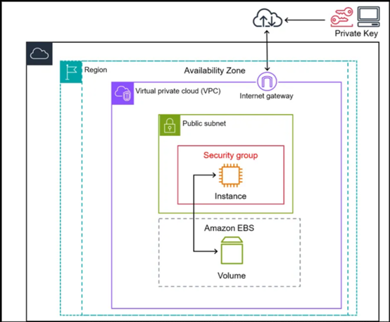

# Day 06 : Launch EC2 Instance

## 🎯 Task :

Create an EC2 Instance with the below details :
1. **Instance Name :** xfusion-ec2
2. **Instance Type :** t2.micro
3. **AMI Image :** Amazon Linux AMI
4. **Key Pair Name :** xfusion-kp ( Create a new RSA Key Pair )
5. Attach the **default Security Group** (available by default)

#### **AWS Menu Navigation :**
AWS Console [ Region : N. Virginia ] --> EC2

## 🌍 Real-World Scenario : 

1. Highly Available Web Application Architecture

	**Scenario :** A retail company needs to host an e-commerce platform that can handle unexpected traffic surges (e.g., Black Friday) while remaining highly fault-tolerant.
	* **The Solution :** Build a multi-tier, auto-scaling architecture.
	* **How it Works :**
		* **Public Subnet :** Hosts an AWS Application Load Balancer (ALB) to receive internet traffic and handle SSL termination.
		* **Private Subnet :** Houses the actual EC2 instances running the application logic. Isolating these instances keeps them safe from direct public exposure.
		* **Auto Scaling Group (ASG) :** Automatically spins up new EC2 instances across multiple Availability Zones (AZs) when CPU utilization spikes past 70%, and scales down when traffic drops.
		* **Database :** Connects to an Amazon RDS instance running in a Multi-AZ deployment for automated failover.

2. High-Performance Batch Processing & Big Data

	**Scenario :** A media company needs to process millions of video transcodes or run heavy financial risk simulations overnight, but wants to keep infrastructure costs as low as possible.
	* **The Solution :** Use an ASG mixing On-Demand and Spot Instances with Amazon Elastic Block Store (EBS) or Amazon S3 for persistent state management.
	* **How it Works :**
		* Because the processing tasks can be interrupted and retried, the company uses Spot Instances (spare AWS capacity) to save up to 90% compared to On-Demand pricing.
		* If AWS needs the capacity back, the instance receives a 2-minute interruption notice. The application saves its state to an attached encrypted EBS volume or S3 bucket before the instance terminates.
		* A baseline of On-Demand Instances ensures that the critical controller nodes orchestrating the jobs never go down.

3. Secure Internal Microservices (No Internet Access)

	**Scenario :** A bank runs a backend payment processing microservice on EC2 that must never be accessible from the public internet, but still needs to securely download software patches and connect to internal AWS services.
	* **The Solution :** Deploy instances in a fully isolated private subnet utilizing a NAT Gateway and VPC Endpoints.
	* **How it Works :**
		* The EC2 instances are given only private IP addresses (no public IPs).
		* Outbound traffic to the internet (for software updates) is routed through a NAT Gateway sitting in a public subnet. This allows outbound requests but blocks initiation of inbound traffic from the internet.
		* To communicate with storage services like Amazon S3 or DynamoDB, the traffic bypasses the public internet entirely by routing through an internal VPC Gateway Endpoint, minimizing data exposure risks.

4. Direct Production Troubleshooting Scenarios

	Cloud engineers frequently face real-world operational challenges when managing EC2 fleets.\
	The table below outlines common failures and their architectural resolutions:

	| Real-World Problem | Root Cause | Resolution Strategy |
	| --- | --- | --- |
	| Instance Not Reachable via SSH | Incorrect Security Group rules, missing Internet Gateway route, or corrupted SSH keys. | 1. Verify Port 22 is open to our specific IP in the Security Group. 2. Ensure the instance has a public IP and sits in a public subnet. 3. Use AWS Systems Manager Session Manager to securely log in without needing SSH keys or open ports. |
	| ALB Health Checks Failing | The web application crashed, or the Security Group blocks the Load Balancer's internal IP range. | 1. Check the local application logs to see if the web service (e.g., Nginx, Apache) is running. 2. Update the EC2 Security Group to explicitly allow inbound HTTP/HTTPS traffic originating from the ALB's Security Group. |
	| Data Lost After a Reboot | Critical data was written to an Instance Store volume instead of an EBS volume. | Instance Store is ephemeral (temporary) hardware storage that wipes upon instance termination or certain stops. Always mount persistent application data, databases, and logs onto Amazon EBS volumes. |
	| Placement Group Capacity Error | Attempting to scale out instances in a Cluster Placement Group fails because contiguous physical rack space is full. | Stop all instances in the placement group, then start them all together. This forces AWS to migrate the entire cluster to a physical section of the data center that has enough contiguous space to accommodate the new fleet size. |

5. Cost Optimization Scenarios

	**Scenario :** A company realizes its monthly AWS bill is skyrocketing due to hundreds of unoptimized EC2 workloads running 24/7.
	* **The Solution :** Implement a multi-tiered cost-saving strategy using AWS Native tools.
	* **How it Works :**
		* **Predictable Workloads :** For core database and application servers that must run continuously, purchase an EC2 Instance Savings Plan or Reserved Instances to secure up to a 72% discount in exchange for a 1- or 3-year commitment.
		* **Non-Production Environments :** Use AWS Instance Scheduler to automatically turn off Development and QA EC2 instances outside of business hours (e.g., 7 PM to 7 AM and weekends), instantly saving ~65% on compute costs for those environments.
		* **Right-sizing :** Review AWS Compute Optimizer recommendations to catch instances that are over-provisioned (e.g., running an m5.2xlarge when CPU utilization never exceeds 5%) and safely downsize them to a smaller type (like a t3.medium).

## ✅ AWS EC2 Best Practices :

AWS EC2 best practices ensures our infrastructure is secure, highly available, cost-effective, and easy to maintain.

1. Security & Identity (Most Critical)

	* **Enforce Least Privilege with IAM Roles :** Never embed AWS root credentials or access keys directly within the applications or EC2 code. Instead, assign permissions using AWS Identity and Access Management (IAM) Roles.
	* **Strict Security Groups :** Avoid utilizing default security groups. Always build custom security groups restricting inbound traffic to minimal necessary IP ranges and specific ports (e.g., locking down port 22/3389 instead of exposing it to 0.0.0.0/0).
	* **Isolate Subnets :** Avoid provision of backend workloads or databases within public subnets. Isolate backend apps to private subnets and orchestrate public-facing incoming traffic using Elastic Load Balancing (ELB).
	* **Secure Remote Access :** Avoid exposing raw SSH/RDP ports to the public internet. Transition to AWS Systems Manager Session Manager to enable secure shell access without needing an exposed public IP or bastion host.

2. High Availability & Resilience

	* **Distribute Across Availability Zones (AZs) :** Mitigate data center outages by distributing instance arrays evenly across multiple Availability Zones within an AWS Region.
	* **Leverage Auto Scaling :** Combine the deployments with Amazon EC2 Auto Scaling. This automatically manages instance capacity, addresses erratic traffic peaks, and seamlessly spins up healthy alternative nodes during failure.
	* **Dynamic IP Handling :** Avoid linking software logic directly to local ephemeral public IPs, which change whenever an instance restarts. Utilize Elastic IPs or attach instances to an Application Load Balancer instead.

3. Storage Optimization

	* **Separate OS and Data Volumes :** Provision independent Amazon Elastic Block Store (EBS) volumes for our Operating System and active application data. This approach lets us scale, snapshot, or swap data structures without interrupting basic OS configurations.
	* **Enforce Encryption :** Turn on default encryption parameters for all data residing inside EBS volumes and corresponding snapshot layers.
	* **Isolate Temporary Data :** Rely exclusively on fast, local Instance Store volumes for temporary data like swap files, caches, or scratch spaces, rather than taxing persistent EBS performance.

4. Cost Optimization & Right-Sizing

	* **Embrace the Latest Generation :** Continually audit the infrastructure to ensure we are relying on latest-generation instances (e.g., choosing m6i or m7i variations over outdated m5 shapes) to capture improved performance baselines at cheaper price matrices.
	* **Mix Pricing Strategies :** Mix and match allocation architectures to save on operational expenses :
		* **Savings Plans / Reserved Instances :** Best for persistent, baseline production architectures.
		* **Spot Instances :** Leverage spare AWS capacity to claim up to a 90% discount for stateless, flexible, or fault-tolerant processes (like batch jobs). Ensure instance diversification across multiple types and sizes when deploying Spot targets to reduce interruption impacts.

5. Monitoring & Maintenance

	* **Track Custom Infrastructure Health :** Configure Amazon CloudWatch metrics dashboard integrations to maintain visual logs covering our system status check validations, CPU footprints, and network throughput thresholds.
	* **Automated Patching Loops :** Establish routine update paths for all local applications and base operating systems using tools like AWS Systems Manager Patch Manager to close potential vulnerability openings.

## 📚 What is an EC2 ?

An Amazon EC2 (Elastic Compute Cloud) instance is a virtual server running in the Amazon Web Services (AWS) cloud that lets us rent and configure computing power on demand.

Amazon EC2 (Elastic Compute Cloud) serves as the fundamental compute foundation for cloud architecture. In production environments, EC2 is rarely used as an isolated virtual machine; instead, it is integrated with networking, security, and scaling services to solve specific business challenges.

#### **Key Concepts**

* **Virtual Server ("Instance") :** Instead of buying and maintaining physical hardware, we spin up a software-based computer in the cloud with our choice of operating system (such as Amazon Linux, Ubuntu, Windows Server, or Red Hat).
* **Full Control :** We have root/administrator access to the operating system, allowing us to install applications, configure firewalls, and apply updates ourself.
* **Elasticity :** We can launch, resize (scale up or down), or terminate instances in minutes depending on our traffic or compute needs.
* **Pay-As-You-Go Billing :** We are typically billed by the second or hour for the time the instance is actively running.

#### **EC2 Instance Families**

AWS categorizes instances into different "families" depending on the resource balance our workload requires :
* **General Purpose (e.g., t3, m6) :** Offers a balanced mix of CPU, memory, and networking; great for web servers and development environments.
* **Compute Optimized (e.g., c6) :** High ratio of CPU power to memory; ideal for batch processing, media transcoding, or high-performance computing.
* **Memory Optimized (e.g., r6) :** High RAM capacity designed for in-memory databases and real-time big data analytics.
* **Storage Optimized (e.g., i3) :** High-speed, low-latency local storage for heavy read/write database operations.
* **Accelerated Computing (e.g., p4, g4) :** Uses hardware accelerators or GPUs for machine learning, AI model training, and graphics rendering.

